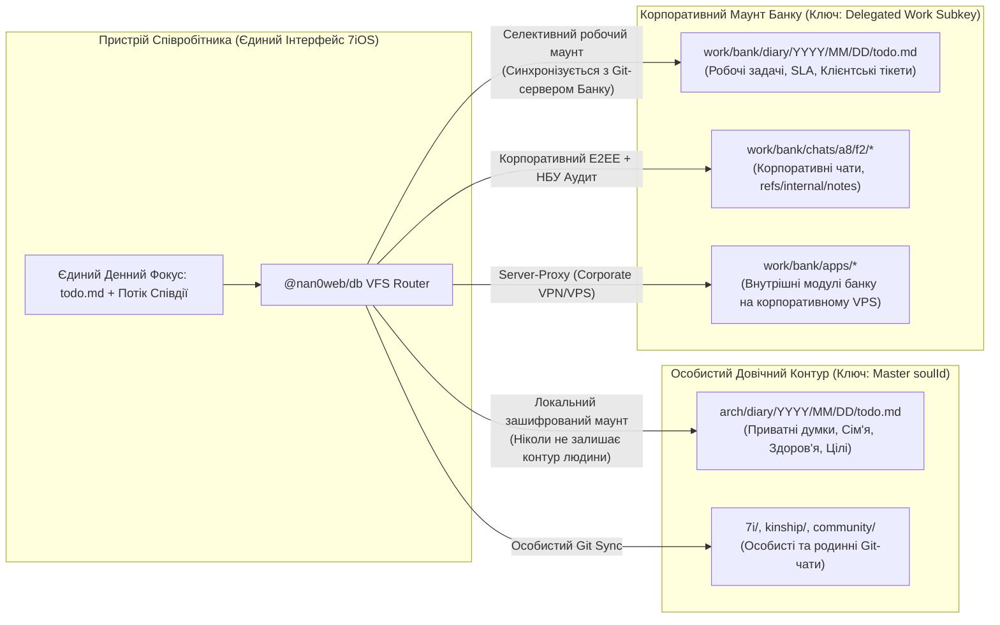
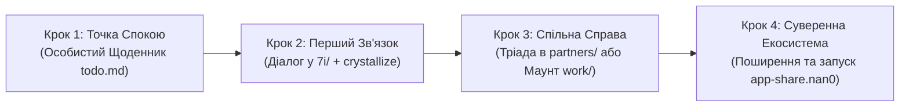

# 🌐 Глибокий Аналіз Ринку, Конкурентів та Архітектури Подвійного Суверенітету: `@nan0web/communication.app` (`7iOS.CoCreation`)

> **Суть платформи:** Перехід від відчужених корпоративних месенджерів і розрізнених таск-трекерів до **Суверенного Простору Співдії (Co-Creation Repo)**, де кожен чат є автономним Git-репозиторієм (`Ref-per-Peer`), інтегрованим через `@nan0web/db` VFS із особистим довічним щоденником людини (`7iOS` / `arch/diary`) та відкритою модульною екосистемою додатків (`App Sharing Protocol`).

---

## 1. Зведена Таблиця Ключових Фіч та Світових Аналогів

У таблиці зіставлено 25 визначальних можливостей `@nan0web/communication.app` (відібраних із матриці 60 фіч [`docs/feature-matrix.md`](./feature-matrix.md), інтеграції `7iOS/Diary` та `App Sharing Protocol`) проти лідерів 3 індустрій:
- **Месенджери:** Telegram, Signal, Slack, Discord, Matrix/Element, Nostr.
- **Project Management & Enterprise ServiceDesk:** Linear, Jira, Zendesk / Intercom.
- **Документи та PKM (Personal Knowledge Management):** Notion, Obsidian, Anytype.

| # | Фіча / Архітектурний механізм | Як реалізовано в `communication.app` | Світові аналоги | Де обходимо конкурентів | Де програємо (ризики) | Що покращити в `v0.2.0`–`v0.4.0` | Сенс та Пріоритет ($Score$) |
| :-: | :--- | :--- | :--- | :--- | :--- | :--- | :--- |
| **1** | **1 Чат = 1 Git-Репозиторій + Компактний Mesh-Транспорт** | Кожен учасник пише у власну гілку `refs/heads/peers/<soulId>` у `chat/YYYY/MM/DD/<ts>-<peer>.md`. Для щоденної синхронізації (вкл. радіо-меш / блекаут) — компактні дельта-пакети (`zstd`/CBOR ~150–400 Б) + `Epoch Snapshots` (`refs/epochs/YYYY-MM`) для груп 1000+. | Matrix (DAG подій), Nostr (Relay JSON), Meshtastic, Slack/TG | Нульові merge-конфлікти; економія трафіку в 10–50 разів у компактному режимі (працює навіть через радіо-меш у блекаут); повна автономність історії. | Компактний дельта-формат поступається стандартному `git fetch` сумісністю зі звичайними Git-клієнтами (потребує локального збирача комітів) та менш ефективний при первинному клонуванні великих архівів без `packfile`. | Зробити **Компактний Дельта-Режим** базовим для live-обміну, а стандартний `git fetch/packfile` — для первинного клонування та архівного бекапу; ранній шардінг `chats/a8/f2/` перенести у `v0.2.0`. | **Ядро (8 000)** — фундамент суверенітету |
| **2** | **Split-Mount Diary (`7iOS` $\leftrightarrow$ Робота/Банк)** | Особистий щоденник `arch/diary/YYYY/MM/DD/todo.md` належить людині довічно, а робочі чати монтуються через VFS як `work/<org>/` із селективним фільтром `[scope:work]`. | Немає прямих аналогів (Obsidian — лише особистий; Jira/Slack — лише корпоративні) | **Блакитний океан:** людина не втрачає свій інтерфейс життя, звички і ритм при зміні роботи, а банк/корпорація отримує чистий робочий зріз без вторгнення в приватність. | Вимагає чіткого криптографічного та UI-розмежування, щоб людина випадково не опублікувала приватну нотатку в робочий маунт. | Візуальний індикатор контуру в UI (золотий/зелений = приватний `7i/`, синій = корпоративний `work/`) + жорсткий VFS-guard у `CrystallizeModel`. | **Критичний (9 000)** — головний драйвер Life+Enterprise |
| **3** | **`crystallize` (Повідомлення $\to$ Задача / Документ)** | Детермінований перенос повідомлення в `todo.md`, `docs/*.md` або `diary/today` зі збереженням `$ref` та `@soulId` автора. | Slack ("Create Jira Issue"), Linear Asks, Telegram Saved Messages | Миттєва трансформація всередині одного репозиторію за `< 1 мс` без зовнішніх вебхуків, платних конекторів чи втрати контексту. | У складних корпоративних процесах потрібна зворотна синхронізація статусів між багатьма репозиторіями. | У `v0.2.0` реалізувати двосторонній реактивний зв'язок: закриття `- [x]` у щоденнику автоматично закриває задачу в чаті проєкту. | **Ядро (8 000)** — кінець втрати домовленостей |
| **4** | **Спільні документи прямо в чаті (`docs/*.md`, `README.md`)** | Документи живуть у тому ж Git-репо, що й потік повідомлень; рендеряться через `@nan0web/markdown` (Mermaid + KaTeX). | Notion, Slack Canvas, Google Docs, Obsidian Publish | Документ і його обговорення не розірвані між двома сервісами; кожна правка має криптографічний `git log` і автора. | Відсутність звичного для нетехнічних користувачів WYSIWYG-редагування таблиць у стилі Notion. | Додати в Web PWA (`v0.3.0`) візуальний блок-редактор поверх чистого Markdown та інтерактивні таблиці `.yaml`/`.csv0`. | **Ядро (9 000)** — основа Co-Creation |
| **5** | **Історія версій та Візуальний Diff у картці чату** | Нативний `git diff` показує в потоці чату точну різницю («Було $\to$ Стало») з можливістю `Approve / Revert` у 1 клік. | GitHub PRs, Google Docs Suggesting Mode, Notion Page History | Переносить потужність Git code-review у звичайний людський чат для юристів, авторів, менеджерів і розробників. | Сирий unified diff важкий для сприйняття людьми без технічного бекграунду. | Рендерити людський Word-level inline diff (зелене додано / червоне закреслено) без технічних заголовків `@@ -1,4 +1,5 @@`. | **Високий (7 200)** — `v0.2.0` |
| **6** | **App Sharing Protocol (`client-only` & `server-proxy`)** | Поширення додатків прямо в чаті через маніфест `app-share.nan0` із декларативними правами доступу до VFS чату. | Telegram Mini Apps (WebApps), Slack Apps, Discord Activities | У Telegram/Slack додаток — це зовнішній iframe на чужому сервері. У `nan.web` режим `client-only` працює на 100% локально з власними API/LLM-ключами користувача (BYOK). | Потребує суворої пісочниці (Sandbox), щоб сторонній модуль не прочитав сусідні маунти `i/` або `7i/`. | Жорстка ізоляція VFS-префіксів на рівні інжекції `this.$db` (модуль бачить лише дозволену підпапку чату). | **Стратегічний (8 100)** — основа `nan.web store` |
| **7** | **Фрактальна Адресна Книга `7iOS` + Правило Тріади ($N \ge 3$)** | Розподіл контактів по 7 канонічних колах (`7i`, `kinship`, `partners`, `law`, `community`, `services`, `inbox`). | Telegram Folders, Discord Categories, CRM Pipelines | Замість хаосу з 200 чатів — природна онтологія людських стосунків ($K \le 7$) та захист спільних проєктів правилом Тріади ($N \ge 3$). | Новим користувачам може бути незвична термінологія 7 кіл на першому старті. | Зробити дефолтні зрозумілі підказки в UI для кожного кола та плавний перенос із `inbox/`. | **Ядро (8 000)** — реалізовано в `v0.1.0` |
| **8** | **Політика Злиття Документів (`auto-ort`, `pr-in-chat`, `owner-only`)** | Налаштовується в `_.nan0` кожного чату: автоматичний merge, пропозиція змін у чат або запис лише власником. | GitHub Branch Protection, Google Docs Permissions | Гнучкість від повної демократії в Тріаді до суворої ієрархії в банківському чи освітньому каналі. | Конфлікт у одному рядку Markdown при `auto-ort` все одно потребує вирішення. | Автоматичний перевод конфліктного `auto-ort` у картку `pr-in-chat` із кнопками вибору варіанту А або Б. | **Ядро (7 500)** — реалізовано в `v0.1.0` |
| **9** | **Миттєвий Повнотекстовий Пошук (`< 5 мс`)** | Локальний інвертований індекс у пам'яті / IndexedDB по всіх повідомленнях і документах `docs/*.md`. | Telegram Search, Slack Search (хмарний), Obsidian Omnisearch | Працює миттєво (`< 5 мс`) і повністю офлайн по зашифрованих E2EE даних (тоді як хмарний пошук неможливий без розшифровки на сервері). | Індекс у пам'яті при 1M+ повідомлень потребує шардованого підвантаження. | У `v0.3.0` зберігати шардовані снапшоти індексу по місяцях (`chat/YYYY/MM/.index.nan0`). | **Високий (6 300)** — ядро в `v0.1.0`, шардінг у `v0.3.0` |
| **10** | **Поширення Файлів через Зовнішні `Volumes` (Zero-Copy)** | Монтування зовнішнього диску (R2/S3, корпоративний NAS, локальний SSD) у `_.nan0` чату зі статусом `ONLINE/OFFLINE`. | Google Drive Links, Dropbox, Nextcloud, Slack File Shares | Нульове дублювання гігабайтів байтів; можливість фізично вимкнути диск (`OFFLINE`), миттєво закривши доступ навіть учасникам чату. | Коли том `OFFLINE`, учасники бачать лише метадані та прев'ю-кеш. | Зберігати легкі метадані (розмір, `sha256`, мініатюру WebP 60%) у Git-репо чату для контексту навіть при `OFFLINE` томі. | **Високий (6 300)** — модель у `v0.1.0`, мережеві драйвери в `v0.3.0` |
| **11** | **Відправка Медіа з CAS `sha256` та `WebP`/`Opus`** | Контентно-адресоване сховище `media/<sha256>` із детермінованим стисненням зображень (`WebP 60/75/90/100`) та аудіо (`Opus`). | Telegram Media Cloud, Signal Attachments, Git LFS | Один і той самий файл, пересланий 100 разів у різних чатах, займає місце лише 1 раз завдяки `sha256` дедуплікації. | Зберігання бінарних медіа напряму в Git роздуває `.git/objects`. | Виносити блоби `media/<sha256>` у окремий CAS-шар `@nan0web/db`, залишаючи в Git лише легкі YAML/Markdown-вказівники. | **Високий (6 300)** — політика в `v0.1.0`, CAS-драйвер у `v0.3.0` |
| **12** | **Шардінг 1M+ Чатів (`chats/a8/f2/`)** | Дворівневий префіксний шардінг директорій за хешем репозиторію (256 $\times$ 256 = 65 536 бакетів). | Zendesk, Intercom, Банківські контакт-центри (PostgreSQL/ScyllaDB) | Дозволяє файловій системі та VFS тримати мільйони клієнтських тікетів без деградації `readdir` і без важких СУБД. | Прямий перегляд папки `chats/a8/f2/` людиною менш наочний, ніж плоский список. | Віртуальні симлінки / індекс активних тікетів у `run/` та `inbox/` для миттєвого огляду оператором. | **Високий (6 300)** — `v0.3.0` (Enterprise Scale) |
| **13** | **Крипто-Сертифікати та Мульти-Підпис (`.nan0` + Ed25519 + КЕП)** | Документи (сертифікати УША, договори, банківські виписки) підписуються масивом ключів `signatures[]` (`Ed25519` + КЕП) і верифікуються офлайн. | DocuSign, Дія.Підпис, Verifiable Credentials (W3C) | Жодної залежності від сторонніх CA; кожна організація тримає свій каталог публічних ключів (`.well-known/nan0-keys.json`) на власному сервері. | Вимагає довіри до домену/сервера організації, що публікує свій каталог ключів. | Додати підтримку ланцюжка підписів (емітент + КЕП + Тріада) у `MediaPolicyModel` / `Vault`. | **Високий (6 300)** — команда `cert` у `v0.1.0`, зовнішній модуль УША в `v0.2.0` |
| **14** | **Пріоритезація Задач за Формулою $P(x)$ та Бейджі `release.app`** | Кожна задача в `todo.md` має ваги $w_L, w_F, w_S$ та бейджі `[from:...] [age:Nd] [prio:...]`, сумісні з `release.app`. | Jira Priorities, Linear Urgent/High/Med/Low, Rice Scoring | Єдина математична формула життєвого і проєктного фокусу + автоматичний радар застряглих задач (`stale >= 3d`). | Ручне виставлення трьох коефіцієнтів може здаватися складним у швидкому діалозі. | Автоматичний пресет ваг при `crystallize` залежно від кола (`7i/` $\to$ високий життєвий пріоритет, `inbox/` $\to$ базовий). | **Високий (7 200)** — `v0.2.0` |
| **15** | **Редагування Повідомлень із Прозорим Аудитом** | Кожне редагування — це новий коміт у файл `peers/<soulId>`. Актуальний текст показується одразу, а історія правок доступна в `git log`. | Telegram/Slack (позначка "edited" без історії), Matrix (події заміни) | Повна чесність у ділових, юридичних та банківських переговорах: завжди видно, що саме і коли було змінено. | Якщо людина випадково вставила пароль чи токен у чат, звичайний коміт залишить його в історії. | Додати команду `purge-secret` (локальний `git filter-repo` / tombstone з інвалідацією блоба для випадково злитих секретів). | **Високий (7 290)** — `v0.2.0` |
| **16** | **Статуси Чатів-Тікетів (`open`, `pending`, `closed`) та Внутрішні Нотатки** | Поле `status:` у `_.nan0` чату + окрема зашифрована гілка `refs/internal/notes`, невидима для зовнішнього клієнта. | Zendesk, Intercom, Jira Service Management | Перетворює будь-який клієнтський чат на повноцінний тікет-деск без купівлі Zendesk (\$100+/міс за агента). | Вимагає суворого контролю на рівні Git-сервера/реєстру, щоб клієнт не міг зробити `git fetch refs/internal/*`. | Фільтрація `upload-pack` / `receive-pack` за списком `@soulId` команди підтримки в `PeerGitSyncModel`. | **Високий (7 200 / 4 860)** — статуси в `v0.2.0`, внутрішні гілки в `v0.3.0` |
| **17** | **Кастомні Стилі Чату + Персональний Override (Доступність)** | Фон, палітра, типографіка задаються в `_.nan0` чату, але **особистий стиль користувача (User Override)** завжди має вищий пріоритет (критично для людей із вадами зору). | Telegram Chat Themes, Discord Server Templates | Бренд компанії чи школи версіонується в Git як код, але ніколи не ламає доступність та комфорт конкретного читача. | Ризик нечитабельних контрастів у темі за замовчуванням. | Валідація WCAG-контрасту в `MediaPolicyModel` + перемикач «Тема чату / Моя тема». | **Середній (5 040)** — модель у `v0.1.0`, UI-рендер у `v0.3.0` |
| **18** | **Вкладені Посилання `[[WikiLinks]]` та Локальний Індекс Backlinks** | Нативний резолв `[[docs/architecture]]` та зворотний індекс посилань у `.index/backlinks.csv0` (`targetUri,sourceUri,commitSha,snippet`). | Obsidian, Notion Backlinks, GitHub PR Line Comments | Поєднує граф знань у стилі Obsidian із точковими коментарями до блоку документа; компактний `.csv0` індекс перебудовується локально і не засмічує Git-потік. | При зміні документа старі номери рядків `#L42` зміщуються. | Прив'язувати анкор до текстового сніпета та хешу коміту; зберігати зворотний індекс у `.index/backlinks.csv0` (або IndexedDB у PWA). | **Високий (5 760 / 4 032)** — `v0.3.0`–`v0.4.0` |
| **19** | **Мульти-Девайс Сесії (`Master soulId` + `Device Subkeys`)** | Головний ключ людини підписує делеговані `deviceKey` (ноутбук, смартфон, робочий ПК) через QR-код. | Signal Linked Devices, Telegram Active Sessions, Matrix Cross-Signing | На робочому ПК у банку можна авторизувати **обмежений корпоративний Subkey** (який має доступ лише до маунту `work/bank/`, але не має ключів від приватного `i/` чи `7i/`!). | Втрата `Master soulId` без резервної фрази означає втрату кореневої ідентичності. | Механізм Social Recovery (Shamir's Secret Sharing між 3–5 довіреними контактами з кола `7i/` та `kinship/`). | **Критичний (6 400)** — модель у `v0.1.0`, крипто-хендшейк у `v0.2.0` |
| **20** | **WebRTC P2P Дзвінки + Авто-Транскрипт у `chat/YYYY/MM/DD/call.md`** | Прямий P2P аудіо/відео зв'язок через сигналінг `chat.yaro.page` із локальним записом та збереженням Markdown-транскрипту в репо чату. | Zoom + Otter.ai / Fireflies, Discord, Slack Huddles, Telegram Calls | Замість втрачених розмов або платних AI-ботів (\$20–30/міс) — кожен дзвінок автоматично стає шуканим Markdown-артефактом у Git-історії проєкту, з якого за 1 клік робиться `crystallize` у задачі! | Локальна транскрибація (`mova.app` / Whisper WebGPU/ONNX) на слабких телефонах може споживати батарею. | Підтримка гібридного режиму: локальна транскрибація на десктопі учасника або через підключений `server-proxy` модуль `mova.app`. | **Високий (4 860 / 4 500)** — `v0.4.0` |
| **21** | **OLMUI Мульти-Інтерфейс (CLI `nan0com`, Web PWA, VS Code Extension)** | Єдине доменне ядро працює в терміналі, у браузері/смартфоні (PWA) та всередині IDE розробника без дублювання бізнес-логіки. | Slack/Discord (лише важкий Electron/Web), Nostr/Matrix (десятки несумісних клієнтів) | Розробник відповідає в чаті й закриває задачі прямо з VS Code або CLI, менеджер — із Web PWA на смартфоні, і всі вони працюють з одним Git-репо. | Підтримка паритету UI-компонентів між CLI, Web та VS Code потребує дисципліни. | Суворе дотримання OLMUI-схем (`ModelAsApp` + декларативні метадані полів). | **Стратегічний (8 000)** — CLI у `v0.2.0`, PWA у `v0.3.0`, VS Code у `v0.4.0` |
| **22** | **Векторний Семантичний Пошук (`nan0ai find`)** | Опційна векторна БД (`@nan0web/ai`, команда `nan0ai find`) для пошуку за змістом по `docs/` та архіву чатів, якщо дозволяє CPU та конфіг. | Notion AI (\$10/міс), Slack AI (\$10/міс за юзера), Intercom Fin | Працює без передачі корпоративних секретів у публічні хмари; налаштовується як глобально, так і індивідуально в `_.nan0` конкретного чату. | Векторні індекси мають більший розмір, ніж інвертований текстовий індекс. | Генерувати ембедінги за конфігом (глобальним або чату) переважно для кристалізованих документів (`docs/*.md`, `todo.md`, `call.md`). | **Середній (3 645)** — `v0.4.0` |
| **23** | **Зникаючі Повідомлення (TTL) / Віртуальні Фони (Blur) / Live Stream** | Відсічено на рівні архітектурного скорингу ($Score < 500$). | Signal/TG (TTL), Zoom/Meet (Blur), Discord/Twitch (Stream) | Ми не витрачаємо тисячі годин на фічі «економіки втечі» чи розмиття фонів, зберігаючи ядро легким, швидким і сфокусованим на співдії. | Частина користувачів, звиклих до ефемерних чатів, може запитувати про TTL. | Для тимчасових технічних секретів використовувати одноразові E2EE WebRTC DataChannel повідомлення поза Git-комітами. | **Відсічено (120–450)** — не входить у ядро |

---

## 2. Аналіз Ринку та Валідація Цінності (Value Proposition)

### 2.1. Чому ми НЕ створюємо «ще один складний комбайн»?

Головна пастка сучасних платформ (Notion, ClickUp, Jira, MS Teams) — це **монолітне роздування (Bloatware)**. Вони намагаються зашити в одне ядро все: і бази даних, і CRM, і таблиці, і чати, і специфічні бізнес-процеси. В результаті інтерфейс гальмує, а користувач тоне в десятках меню.

`@nan0web/communication.app` вирішує цю проблему через **три архітектурні закони простоти**:
1. **Єдиний атом даних — чистий текст (Markdown / `.nan0`) у Git:** Повідомлення в чаті, сторінка документації, список задач `todo.md`, транскрипт дзвінка `call.md` і навіть конфігурація стилю `_.nan0` — це просто текстові файли в одному репозиторії. Жодних прихованих пропрієтарних форматів.
2. **Винесення специфіки в модулі (`App Sharing Protocol`):** У ядрі `communication.app` немає специфічної логіки для шкіл (УША), банківських кредитних конвеєрів, бухгалтерії чи перекладу аудіо. Ядро надає лише **Спільний Простір (Чат + Документи + Задачі + VFS-порти)**. Будь-яка вузька бізнес-логіка підключається як легкий зовнішній модуль (`app-share.nan0`) з `nan.web store` або корпоративного VPS.
3. **Поступове розкриття (Progressive Awakening):**
   - Для нової людини на старті це виглядає простіше за Telegram чи Apple Notes: **один чистий екран чату і один список справ на сьогодні (`todo.md`)**.
   - Коли з'являється потреба зберегти важливу думку з діалогу — людина натискає одну дію: **`crystallize`**.
   - І лише коли команда росте до рівня спільного підприємства чи банку — розкриваються гілки `Ref-per-Peer`, політики `pr-in-chat`, шардінг `chats/a8/f2/` та підключення серверних модулів.

### 2.2. Головна точка диференціації (Формула Унікальності)

$$\text{CoCreation} = (\text{1 Чат} \equiv \text{1 Git Repo}) \times \text{Ref-per-Peer} \times \text{7iOS Split-Mount Diary} \times \text{App \& Data Sharing}$$

Жоден конкурент на ринку не має перетину всіх чотирьох осей:
- **Telegram / Slack / Discord** мають швидкі чати та ботів, але **не мають суверенітету даних**, не мають нативного Git-версіонування документів і розривають зв'язок між особистим життям людини та робочими задачами.
- **Linear / Jira** чудово трекають задачі, але **відірвані від живого діалогу** (переписка все одно йде в Slack/Telegram, де губиться 80% контексту) і належать виключно корпорації.
- **Obsidian / Logseq** дають суверенний локальний Markdown-щоденник, але вони **однокористувацькі (Single-Player)** — у них немає нативного P2P/Git-месенджера, групових чатів `Ref-per-Peer`, тікетів чи поширення живих додатків.

---

## 3. Прорив для Enterprise: «Суверенна Людина всередині Банку та Корпорації» (Split-Mount Diary & Dual-Sovereignty)

> *"У банку чи корпорації працюють живі люди, у яких є власний щоденник і власне життя. Частину цього щоденника вони ведуть приватно і ніколи не передають корпорації, а робочу частину — віддають у спільну справу. І де б людина не працювала, змінила вона роботу чи відкрила власну справу — вона зберігає свою систему `7iOS` для поліпшення і свого життя, і роботи, і взаємодії з іншими."*

### 3.1. Фундаментальна вада сучасного Enterprise-софту (Феодалізм Облікових Записів)

Сьогодні корпоративний ІТ побудований за моделлю **цифрового кріпацтва**:
1. Людина приходить у Банк А. Їй видають корпоративний акаунт у Jira, MS Teams/Slack, Confluence, Outlook.
2. Вона змушена розривати свою увагу між **особистим життям** (де в неї сімейні справи, здоров'я, навчання, власні цілі в умовному блокноті чи Telegram) та **робочим наглядачем** (Jira/Teams).
3. Через цей розрив виникає хронічний стрес: робочі дедлайни конфліктують із життєвими, бо вони не лежать на одній часовій осі дня.
4. Коли людина звільняється з Банку А і переходить у Компанію Б (або запускає власний проєкт), **її корпоративний акаунт блокується за 1 секунду**. Разом із корпоративними даними людина втрачає свої робочі звички, шаблони, структуру мислення, особисту статистику продуктивності та напрацьовану культуру планування. У новій компанії все починається з нуля в іншому зоопарку програм.

### 3.2. Рішення `7iOS.CoCreation`: Архітектура Подвійного Суверенітету (Dual-Sovereignty VFS)

Завдяки віртуальній файловій системі **`@nan0web/db`** та фрактальній структурі `7iOS`, `@nan0web/communication.app` вперше вирішує конфлікт між **Приватністю Людини** та **Безпекою/Комплаєнсом Корпорації (Банку)**:



#### Як це працює технічно і юридично:

1. **Єдиний екран дня (Unified Daily Focus) при фізичному розділенні даних (Split-Storage):**
   - Коли співробітник банку відкриває вранці свій `7iOS`, VFS `@nan0web/db` агрегує в один візуальний список дня задачі з двох фізично незалежних маунтів:
     - Із приватного `/Users/i/arch/diary/2026/11/20/todo.md` (наприклад: `- [ ] Ранкова пробіжка`, `- [ ] Забрати дитину зі школи о 17:00`).
     - Із корпоративного маунту `work/bank/diary/2026/11/20/todo.md` (наприклад: `- [ ] [from:chat/ticket-9412] [prio:urgent] Погодити кредитний ліміт клієнта`).
   - Людина бачить свій день **цілісно** й сама керує своїм часом та енергією, не розриваючись між 10 програмами.

2. **Абсолютна гарантія приватності для Людини:**
   - Приватний маунт `arch/diary/` та кола `i/`, `7i/`, `kinship/` зашифровані особистим ключем людини і синхронізуються лише з її власним сховищем.
   - Корпоративний сервер банку технічно **не має маршруту** до VFS-префіксів поза `work/bank/`. Жоден системний адміністратор банку не може прочитати приватні записи щоденника співробітника.

3. **Абсолютна гарантія безпеки, DLP та аудиту для Банку / Enterprise:**
   - Усе, що створено в маунті `work/bank/` (або кристалізовано з робочого чату `work/bank/chats/*`), фізично записується **виключно** у корпоративний Git-репозиторій банку та підписується делегованим робочим підключем співробітника (`workSubkey`).
   - Банк отримує:
     - 100% незмінний криптографічний аудит-лог (`git log` з підписами `Ed25519` для перевірок НБУ чи фінансового аудиту).
     - Повний контроль над клієнтською базою (`chats/a8/f2/`), внутрішніми нотатками менеджерів (`refs/internal/notes`) та корпоративними модулями (`server-proxy` на серверах банку).
   - Якщо співробітник використовує робочий ноутбук у банку, він навіть не вводить туди свій `Master soulId` і не монтує повний приватний архів — через QR-код зі свого смартфона він може тимчасово відкривати на робочому місці лише безпечний зріз свого денного розкладу (наприклад, зайняті слоти часу без розкриття приватного тексту).

4. **Безшовна зміна роботи (Career Continuity & Zero Burnout):**
   - Коли контракт із Банком А завершується, банк відкликає доступ `workSubkey` до свого сервера, а співробітник виконує `unmount("work/bank-a")`.
   - **Що залишається банку:** Усі робочі чати, тікети, документація `docs/*.md`, історія комітів та клієнтські справи залишаються в ідеальному порядку в Git-репозиторіях банку.
   - **Що залишається людині:** Її головний життєвий актив — її `7iOS`, її багаторічний щоденник `arch/diary/`, її персональні налаштування, її навичка мислення, її власні `client-only` інструменти. Наступного дня вона підключає `mount("work/company-b")` або відкриває власну практику в `services/` і продовжує жити в тому самому рідному просторі!

---

## 4. Аналіз Цільової Аудиторії (5 Сегментів & ICP)

| Сегмент (ICP) | Головний Біль (НеМір) | Як вирішує `communication.app` (НаМір) | Чому перейдуть (Тригер) | Монетизація / Бізнес-модель |
| :--- | :--- | :--- | :--- | :--- |
| **1. Enterprise: Банки, Фінтех, Сервісні Компанії** *(100 – 10 000+ співробітників)* | Зоопарк із Slack + Jira + Zendesk + Confluence коштує \$80–150/міс за працівника; дані на чужих хмарах; складний аудит для НБУ; вигорання працівників через фрагментацію уваги. | **Self-Hosted Enterprise Git Hub + Split-Mount Diary:** Шардінг 1M+ тікетів (`chats/a8/f2/`), підписи `Ed25519` кожного рішення для регулятора, внутрішні гілки `refs/internal/notes`, підключення банківських систем як `server-proxy` модулів. | Економія 60–80% бюджету на SaaS-ліцензіях + повний суверенітет даних на серверах банку + зростання продуктивності людей завдяки єдиному фокусу дня. | Корпоративна ліцензія на Enterprise-інфраструктуру / платні Enterprise-модулі в `nan.web store` + підтримка розгортання. |
| **2. Суверенні Розробники, AI-Інженери та Автономні Тріади ($N \ge 3$)** | Обговорення в Telegram/Discord відірвані від коду і документації; Linear і Notion вимагають постійного ручного копіювання; AI-агенти не мають прямого доступу до контексту чатів. | **1 Чат = 1 Git-Репо + OLMUI (`nan0com` CLI & VS Code):** Чат, `todo.md` і `docs/*.md` лежать у стандартному Git. AI-агенти та розробники читають і комітять у чат так само легко, як у код. | Можливість керувати проєктом і спілкуватися прямо з терміналу або VS Code за допомогою `crystallize` та `pr-in-chat` без виходу з потоку. | Безкоштовне ядро (Open/Sovereign Core) $\to$ продаж власних AI/Dev-модулів через `nan.web store` (модель `server-proxy` або платні шаблони). |
| **3. Приватні Експерти, Юристи, Консультанти, Лікарі (`services/`, `law/`)** | Спілкування з клієнтами в Telegram/Viber змішане з особистими чатами; немає верифікованої історії правок договорів; важко монетизувати власні AI-інструменти чи бази знань. | **Захищений Клієнтський Репозиторій + `server-proxy` модулі:** Кожна справа клієнта (наприклад, судовий захист у `law/`) — це окремий зашифрований Git-чат із `git diff` документів, чеклістом і вбудованим платним модулем консультанта. | Юридична доказовість кожного повідомлення й правки документа (`Ed25519` + `git log`) та можливість продавати доступ до свого експертного сервісу за підпискою прямо в чаті. | Оренда готового VPS у `nan.web store` (1-click deploy) + комісія або прямий білінг за підписні `server-proxy` модулі експерта. |
| **4. Освітні Спільноти, Школи, Кооперативи (Кейс УША)** | Курси живуть на закритих платформах (Kajabi, GetCourse), чати — в Telegram, сертифікати — це просто картинки PDF, які легко підробити; після курсу спільнота розпадається. | **Живий Репозиторій Навчання + Крипто-Сертифікати `.nan0`:** Матеріали курсу (`docs/*.md`), спільні завдання (`todo.md`) і живий чат групи в одному репо. Модуль школи видає підписаний `Ed25519` сертифікат у `7i/certificates/`. | Нульова абонентська плата стороннім платформам, вічний доступ учня до матеріалів офлайн та криптографічна верифікація дипломів за 1 клік. | Підписка для освітніх закладів на хостинг/реєстр або продаж спеціалізованого модуля сертифікації та навчання в `nan.web store`. |
| **5. PKM-Спільнота (Користувачі Obsidian, Logseq, Notion, `7iOS`)** | Obsidian ідеальний для одного, але в ньому неможливо повноцінно спілкуватися в чаті з родиною чи командою і делегувати задачі без сторонніх милиць. | **Нативний Мультиплеєр для Markdown-Щоденника:** `communication.app` монтує існуючий Markdown-щоденник людини (`arch/diary/`) і додає до нього безконфліктні Git-чати `Ref-per-Peer` та `[[WikiLinks]]`. | Можливість не змінювати улюблений формат локальних `.md` файлів, отримавши повноцінний месенджер і командну співдію поверх своїх папок. | Вірусні амбасадори платформи (Bottom-Up ріст) $\to$ покупка хмарних `Volumes` (R2/S3 бекапи) та модулів із `nan.web store`. |

---

## 5. Слабкі Сторони Конкурентів та Інтеграція `7iOS` у Мислення Людини

### 5.1. Системні вразливості конкурентів, які дозволяють переманити аудиторію

1. **Пастка "Per-Seat Tax" (Податок на кожну людину в Slack / Jira / Notion / Zendesk):**
   - Як тільки в компанії або спільноті стає 50–500 людей, щомісячний рахунок за Slack + Jira + Notion сягає тисяч доларів. Через це компанії бояться додавати в робочий простір підрядників, клієнтів чи партнерів.
   - **Наш удар:** У `communication.app` додавання нового учасника в Git-чат коштує **\$0** (це лише нова гілка `refs/heads/peers/<soulId>`). Компанія платить лише за власні обчислювальні ресурси (VPS/Storage) або конкретні підключені сервіси.
2. **Втрата контексту на стику "Чат $\neq$ Задача $\neq$ Документ":**
   - У Telegram та Slack 90% цінних рішень тонуть у стрічці вже через 2 години.
   - **Наш удар:** Операція `crystallize` робить перехід від слова до діла (`todo.md`) або знання (`docs/*.md`) миттєвим і нерозривним.
3. **Неможливість офлайн-роботи та хмарна залежність:**
   - Notion, Slack, Jira та веб-версії месенджерів паралізуються без інтернету або при збої AWS/Cloudflare.
   - **Наш удар:** Local-First архітектура на `@nan0web/db` (FS на десктопі, IndexedDB/OPFS у Web PWA). Людина читає чати, редагує документи, шукає за `< 5 мс` і пише в щоденник у літаку чи блекауті, а при появі зв'язку `Ref-per-Peer` синхронізує все без жодного конфлікту.

### 5.2. Чотири кроки безболісного входження людини в екосистему `7iOS`

Людину не можна одразу навантажувати всією філософією $7^7$ чи командами Git. Перехід відбувається природно — **від особистої користі до колективної співдії**:



1. **Крок 1. Особиста Опора (`diary/today` через Агента, CLI або PWA):**
   - Людина починає через **AI-агента** (як у Antigravity), CLI або PWA і отримує чистий простір на диску: прості файли без прив'язки до додатка (побут, медична картка, дерево родини, **Книга Буття / щоденник** із можливістю підключити **Раду Мудреців** для самоаналізу). Правила простору описуються у зрозумілому людям і агентам `AGENTS.md` / `_.nan0`.
2. **Крок 2. Перший Справжній Діалог (`7i/` + `crystallize` + Мультимовність):**
   - Людина запрошує близького друга чи партнера. Оригінал повідомлення завжди зберігається мовою автора (`lang: uk`), а кожен учасник (у 1-на-1 або групі) читає своєю мовою через `mova.app` + локальний словник термінів чату `docs/glossary.nan0` (для специфічних слів, які не перекладаються стандартним словником). Під час розмови натискається `crystallize` — і думка стає дією в `todo.md`.
3. **Крок 3. Професійне Розширення (`partners/` та Enterprise Split-Mount `work/`):**
   - Людина створює робочу Тріаду ($N \ge 3$ — квантовість стійкої системи) або підключає корпоративний маунт `work/<company>/` у банку/компанії, де її особистий щоденник залишається 100% приватним.
4. **Крок 4. Творець та Користувач Модулів (`App & Data Sharing` + Боти-Агенти):**
   - У чаті діляться додатками (`app-share.nan0`) та підключають ботів-агентів (із власним `soulId` і правами лише на дозволені гілки `peers/<botSoulId>`).

---

## 6. Деталізація `App Sharing Protocol` (Client-Side vs Server-Side)

Щоб ядро `@nan0web/communication.app` залишалося незмінним і чистим, але могло обслуговувати будь-які сценарії — від шкільних сертифікатів до банківського скорингу та AI-перекладачів — вводиться декларативний протокол поширення додатків у чаті.

### 6.1. Структура маніфесту `app-share.nan0`

Коли учасник ділиться додатком у чаті, у потік `chat/YYYY/MM/DD/<ts>-<peer>.md` (або в `apps/<appId>.nan0` репозиторію чату) записується підписаний ключем автора маніфест:

```yaml
# apps/mova-translator.nan0
appId: "@nan0web/mova.app"
version: "0.2.0"
title: "Мова — Контекстний трансформатор та перекладач"
authorSoulId: "soul:ed25519:yaro..."
signature: "sig:ed25519:8f9a..."
executionMode: "hybrid" # client-only | server-proxy | hybrid

# Декларативні дозволи (Zero-Trust VFS Sandbox)
permissions:
  vfsRead:
    - "docs/**"
    - "chat/**"
  vfsWrite:
    - "docs/translations/**"
  requireSecrets:
    - "OPENAI_API_KEY" # Для client-only режиму (BYOK — підставляється з локального @nan0web/vault отримувача)

# Точки входу
clientBundle:
  casSha256: "sha256:4b227777d4dd1fc61c6f884f48641d02..."
  entryModel: "MovaApp"
serverProxy:
  endpoint: "https://mova.yaro.page/api/v1/run"
  pricingModel: "subscription-token" # free | subscription-token | enterprise-acl
  verifyPubKey: "ed25519:server_pub_key..."
```

### 6.2. Режим 1: `client-only` (Суверенна Копія + Вірусне Залучення через BYOK)

- **Як працює:**
  1. Отримувач у чаті бачить картку додатка і натискає **«Запустити локально»**.
  2. Клієнт перевіряє `Ed25519`-підпис автора та `casSha256` бандла (`ModelAsApp`).
  3. Додаток запускається у **суворо ізольованому VFS-контексті**: йому інжектується `this.$db`, обмежений лише тими шляхами чату, які вказані в `permissions.vfsRead` / `vfsWrite` (доступ до приватного щоденника `arch/diary/` або інших чатів фізично заблокований).
  4. Якщо додатку потрібен зовнішній AI/API (наприклад, `OPENAI_API_KEY` або `ANTHROPIC_API_KEY`), отримувач підставляє **власний ключ** зі свого локального `@nan0web/vault` (модель **BYOK — Bring Your Own Key**).
- **Чому це ідеальний вірусний двигун:**
  - **Для автора додатка:** Витрати на сервери та LLM-токени дорівнюють **\$0**, навіть якщо його додатком поділилися у 100 000 чатів! Автор може безкоштовно роздавати базові `client-only` інструменти як вірусний лід-магніт.
  - **Для користувача та бізнесу:** 100% приватність. Дані чату не відправляються на сервер автора додатка, а обробляються локально на пристрої (або напряму через власний корпоративний API-ключ).

### 6.3. Режим 2: `server-proxy` (Монетизація на Власному VPS та Enterprise-Сервіси)

- **Як працює:**
  1. Автор (або корпорація/банк) розгортає свій сервіс із `nan.web store` на власному VPS (наприклад, приватну LLM-модель, закриту юридичну базу знань, систему видачі дипломів УША або банківський модуль кредитного погодження).
  2. Учасник у чаті взаємодіє з декларативною OLMUI-формою моделі, але виклик `app.run()` виконується через захищений E2EE-запит на `serverProxy.endpoint`.
- **Юридично-технічний захист підписки та доступу (Signed Capability Tokens):**
  - Щоб захистити `server-proxy` від несанкціонованого використання без централізованого білінгового монополіста, використовується криптографічний механізм **Ed25519 Capability Token (Квиток Доступу)**:
    ```yaml
    # Квиток підписки, виданий сервером автора для конкретного користувача або чату
    tokenType: "nan0-capability-v1"
    issuer: "soul:ed25519:author_vps..."
    grantee: "soul:ed25519:client_or_chat_id..."
    appId: "@nan0web/law-advisor.app"
    tier: "pro-monthly"
    quotaRequests: 1000
    expiresAt: "2026-12-20T23:59:59Z"
    signature: "sig:ed25519:..."
    ```
  - При кожному зверненні з чату клієнт підписує запит своїм `soulId` і додає свій `Capability Token`.
  - VPS автора за `< 0.1 мс` перевіряє підпис квитка в пам'яті (Stateless Verification), списує квоту і повертає потік `OutputMessage` назад у чат.
  - **В Enterprise-контурі (Банк):** замість платної підписки сервер банку перевіряє, що `grantee` має чинний корпоративний `workSubkey`, підписаний кореневим сертифікатом департаменту безпеки банку.

---

## 7. Висновки та Вплив на Дорожню Карту Релізів (`releases/0/X/v0.X.0/`)

1. **Ядро `v0.1.0` (`releases/0/1/v0.1.0/task.{md,spec.js}`) залишається чистим і незмінним:**
   - 7 доменних моделей на In-Memory `@nan0web/db` (`FractalContactBookModel`, `ChatRepoModel`, `CrystallizeModel`, `ChatSearchModel`, `MediaPolicyModel`, `PeerGitSyncModel`, `CommunicationApp`).
2. **Пріоритет `v0.2.0` (`releases/0/2/v0.2.0/task.{md,spec.js}`):**
   - Реальний Git-порт (`PeerGitSyncModel`) + **Архітектура Split-Mount Diary (`7iOS` приватний щоденник `/Users/i/arch/diary` + селективний робочий маунт `work/<org>/`)** + двосторонній `crystallize` + контракт `App Sharing Protocol` (`app-share.nan0`) + CLI `nan0com` та `Device Subkeys`.
3. **Пріоритет `v0.3.0` (`releases/0/3/v0.3.0/task.{md,spec.js}`):**
   - Enterprise-масштабування (шардінг 1M+ чатів `chats/a8/f2/`, внутрішні гілки менеджерів `refs/internal/notes`), CAS-медіа та зовнішні `Volumes`, Web PWA клієнт та інтеграція з `nan.web store` (`client-only` пісочниця + `server-proxy` Capability Tokens).
4. **Пріоритет `v0.4.0` (`releases/0/4/v0.4.0/task.{md,spec.js}`):**
   - WebRTC P2P аудіо/відео дзвінки з авто-транскриптом у `chat/YYYY/MM/DD/call.md`, VS Code адаптер, векторний семантичний пошук, Канбан-дошка та коментарі до рядка `#L42`.
