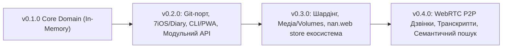

# План впровадження: `apps/communication.app/releases/0/X/v0.X.0/` та Аналіз Ринку

## Мета та Контекст

Наразі в [`apps/communication.app`](file:///Users/i/src/nan.web/apps/communication.app) визначено бачення проєкту ([`project.md`](file:///Users/i/src/nan.web/apps/communication.app/project.md)), матрицю з 60 фіч ([`docs/feature-matrix.md`](file:///Users/i/src/nan.web/apps/communication.app/docs/feature-matrix.md)), глибокий аналіз ринку й Enterprise-архітектури ([`docs/market-analysis.md`](file:///Users/i/src/nan.web/apps/communication.app/docs/market-analysis.md)) та активний контракт [`v0.1.0/task.md`](file:///Users/i/src/nan.web/apps/communication.app/releases/0/1/v0.1.0/task.md) (In-Memory доменне ядро).

З урахуванням архітектурних уточнень:
1. **Канонічна структура релізів (протокол `release.md`):** Замість `releases/backlog/v0.X.0.md` кожен наступний реліз оформлюється у канонічній структурі `releases/0/X/v0.X.0/task.md` та `releases/0/X/v0.X.0/task.spec.js` (із контрактними тестами `it.todo(...)` для запланованих релізів `v0.2.0`, `v0.3.0`, `v0.4.0`).
2. **Модульність замість моноліту:** Специфічні доменні кейси (на кшталт сертифікатів УША, банківських черг чи вузьких бізнес-логік) **не входять** у ядро `communication.app`. Натомість проєктується **точка інтеграції додатків (`App Sharing Protocol` & File-based Sharing)**, щоб окремі додатки платформи та сервіси з `nan.web store` (розгорнуті на власному VPS, безкоштовно або за підпискою) підключалися до `communication.app` як модулі.
3. **Інтеграція з `7iOS`, `/Users/i/arch/diary` та Enterprise Split-Mount Diary (Подвійний Суверенітет):** Включаємо нативну інтеграцію з фракталом `7iOS` (домени `7i/`, `we/`, `arch/diary`) через `@nan0web/db` VFS. Людина веде свій довічний щоденник приватно, а робочу частину (`work/<company>/`) селективно монтує до корпоративного контуру банку чи підприємства — зберігаючи свій життєвий інструмент навіть при зміні роботи.



---

## Деталізація Ключових Архітектурних Рішень

### 1. Детальний план інтеграції `7iOS`, `/Users/i/arch/diary` та Enterprise Split-Mount Diary

Інтеграція реалізується виключно через VFS-маунти `@nan0web/db` (без процедурного `node:fs` у доменних моделях):

1. **VFS-маунти при старті `CommunicationApp` (`v0.2.0`):**
   - `we/` (або `7i/`) $\to$ маунт контактів та кіл `7iOS` (`7i`, `kinship`, `partners`, `law`, `community`, `services`, `inbox`) у `FractalContactBookModel`.
   - `diary/` $\to$ особистий довічний маунт `/Users/i/arch/diary` через `@nan0web/db-fs` (на Node/CLI) або синхронізований Git-репозиторій (у Web PWA).
   - `work/<org>/` $\to$ селективний корпоративний маунт (для банку чи підприємства), який підключається на час роботи в компанії та працює за корпоративним підключем (`workSubkey`). Приватні записи `diary/` та `7i/` фізично ізольовані й ніколи не передаються в `work/<org>/`.
2. **Двостороння синхронізація `crystallize` $\leftrightarrow$ `arch/diary/{YYYY}/{MM}/{DD}/todo.md` та `work/<org>/diary/{YYYY}/{MM}/{DD}/todo.md`:**
   - **Чат $\to$ Щоденник:** При виклику `crystallize(msgUri, "diary/today")` задача записується в `arch/diary/{YYYY}/{MM}/{DD}/todo.md` (або у корпоративний маунт, якщо чат належить `work/<org>/`) із мета-бейджами `[from:chat/<repo>] [author:@soulId]`.
   - **Щоденник $\to$ Чат:** Зміна статусу `- [x]` або `- [>]` у `todo.md` щоденника оновлює статус зв'язаного завдання в чаті проєкту.
   - **Портативність при зміні роботи:** При завершенні співпраці з корпорацією маунт `work/<org>/` відключається (`unmount`), корпорація зберігає свої репозиторії тікетів, а людина зберігає свій `7iOS` та особистий щоденник `arch/diary/`.
3. **Події та Нагадування:**
   - Узгоджені в чаті дедлайни (`due: YYYY-MM-DD`) автоматично проєктуються в календарну структуру `arch/diary/{YYYY}/{MM}/{DD}/todo.md`.
4. **Контрактні тести (`task.spec.js`):**
   - Тест на In-Memory `@nan0web/db` з віртуальним маунтом `diary/` та `work/bank/` перевіряє, що `crystallize` створює запис у `diary/2026/11/20/todo.md` зі збереженням `$ref` на повідомлення і суворою ізоляцією приватного контуру від корпоративного.

### 2. Модульне поширення додатків (App Sharing: Client-Side vs Server-Side)

Оскільки додатки `nan.web` побудовані за OLMUI (агностична доменна логіка), у `v0.2.0`–`v0.3.0` вводиться **App Sharing Protocol** — можливість ділитися в чаті не лише файлами, а й **додатками з правами на запуск і збереження даних**:

1. **Маніфест додатка в чаті (`app-share.nan0`):**
   - Описує: `appId`, `version`, `executionMode` (`client-only` | `server-proxy` | `hybrid`), `permissions` (які VFS-директорії чату доступні для читання/запису).
2. **Режим `client-only` (Суверенна копія):**
   - Отримувач завантажує клієнтський бандл (або відкриває його в Web PWA / мобільному додатку), підставляє **власні API-ключі** (наприклад, для LLM API) і виконує додаток повністю автономно, без жодних звернень до сервера автора.
3. **Режим `server-proxy` (VPS-сервіс / Підписка):**
   - Додаток виконується на VPS власника (`nan.web store` / self-hosted). Чат виступає захищеним UI-клієнтом, який передає запити через E2EE/токен підписки. Це дозволяє власнику монетизувати серверну інтеграцію або надавати доступ спільноті за квотами.

---

## Задача для глибокої аналітики (Market, Competitors & Audience Research)

> [!NOTE]
> **Призначення:** Ця секція сформована як чітке ТЗ для запуску на великій моделі (Deep Research), щоб перед початком масштабної реалізації `v0.2.0+` валідувати ринкову цінність `@nan0web/communication.app` (`7iOS.CoCreation`).

### Очікуваний результат (Deliverable)
Зберегти аналітичний звіт у `apps/communication.app/docs/market-analysis.md` (або в `releases/0/1/v0.1.0/analytics.md`) зі структурою:

1. **Зведена таблиця фіч та світових аналогів:**
   - Порівняти всі ключові фічі з [`docs/feature-matrix.md`](file:///Users/i/src/nan.web/apps/communication.app/docs/feature-matrix.md) + `App Sharing (Client/Server)` + `7iOS/Diary` проти конкурентів:
     - *Месенджери:* Telegram, Signal, Slack, Discord, Matrix/Element, Nostr.
     - *PM та Документи:* Linear, Jira, Notion, Obsidian.
   - Колонки таблиці: `Фіча` | `communication.app` | `Аналоги` | `Де обходимо` | `Де програємо` | `Що покращити` | `Чи має сенс і пріоритет`.

2. **Аналіз ринку та Валідація цінності (Value Proposition):**
   - Чи не створюємо ми «ще один складний комбайн», який незрозумілий користувачу?
   - У чому головна точка диференціації (1 чат = Git-репозиторій + `Ref-per-Peer` + `7iOS` + `App Sharing`)?

3. **Аналіз цільової аудиторії (Сегменти & ICP):**
   - Описати 3–5 конкретних сегментів (напр. суверенні розробники/команди, освітні та локальні спільноти, приватні консультанти/сервіси на VPS через `nan.web store`, користувачі `7iOS`).
   - Для кожного сегмента: *Біль → Як вирішуємо → Чому перейдуть → Готовність платити*.

4. **Слабкі сторони конкурентів та Інтеграція `7iOS` у мислення людини:**
   - Які системні вади конкурентів (vendor lock-in, втрата контексту між чатом і задачами, підписки за кожен чих, відсутність суверенітету даних) дозволяють переманити аудиторію?
   - Як безболісно завести людину в екосистему `7iOS` (від першого простого чату/щоденника до повноцінного простору співдії).

5. **Деталізація `App Sharing Protocol` (Client-Side vs Server-Side):**
   - Юридично-технічна та продуктова модель: як захистити підписку в `server-proxy`, як зробити `client-only` (з власними LLM-ключами) максимально вірусним інструментом залучення.

---

## Proposed Changes

### `apps/communication.app/releases/0/X/v0.X.0/`

Створення канонічних релізних паспортів (`task.md`) та TDD-контрактів (`task.spec.js` із `it.todo(...)`) за стандартом протоколу `release.md`:

#### [NEW] `apps/communication.app/releases/0/2/v0.2.0/task.md` & `task.spec.js`
**Фокус: Реальний Git-порт, Інтеграція з `7iOS` + `/Users/i/arch/diary` (Enterprise Split-Mount Diary), Базовий UI та Модульний контракт**
- **Git-порт та Синхронізація:**
  - Реальний Git-порт для `PeerGitSyncModel` (`isomorphic-git` або Git-CLI без зміни доменного контракту `v0.1.0`).
  - Історія версій та нативний `git diff` документів у картці чату (**Score: 7 200**).
- **Інтеграція `7iOS` + `/Users/i/arch/diary` + Split-Mount `work/<org>/`:**
  - Маунт та синхронізація контактів/кіл `7iOS` (`7i/`, `kinship/`, `partners/`, `law/`, `community/`, `services/`, `inbox/`).
  - Двостороння інтеграція `crystallize` та `todo.md` із календарним щоденником `/Users/i/arch/diary/{YYYY}/{MM}/{DD}/todo.md` та ізольованим корпоративним маунтом `work/<org>/`.
- **Повідомлення та Проєктна робота:**
  - Редагування повідомлень (новий коміт у `peers/<soulId>`, **Score: 7 290**).
  - Закріплені повідомлення `pinned: [...]` у `README.md` / `_.nan0` (**Score: 6 400**).
  - Статуси (`open`, `pending`, `closed`, **Score: 7 200**), пріоритезація за $P(x)$ (**Score: 7 200**), призначення `@soulId` (**Score: 6 480**).
- **Модульний контракт (`App Sharing Protocol`):**
  - Декларативний контракт підключення зовнішніх додатків (`app-share.nan0`) через спільні файли (`.nan0` / `.md`) та ізольовані VFS-порти `this.$db`.
- **Базовий UI та Довіра:**
  - CLI-адаптер `src/ui/cli/` (`nan0com`) на `@nan0web/ui-cli`.
  - Мульти-девайс сесії (`Master soulId` + `Device Subkeys` / `workSubkey` через QR-код) та E2EE рукостискання (`@nan0web/vault`).

#### [NEW] `apps/communication.app/releases/0/3/v0.3.0/task.md` & `task.spec.js`
**Фокус: Масштабування, Медіа/Volumes, Web PWA та `nan.web store` екосистема**
- **Масштабування та Пошук:**
  - Дворівневий префіксний шардінг 1M+ чатів `chats/a8/f2/` (**Score: 6 300**) та внутрішні гілки менеджерів `refs/internal/notes` (**Score: 4 860**).
  - Теги `#tag` з інвертованим індексом (**Score: 5 760**), `[[WikiLinks]]` (**Score: 5 760**).
- **Медіа та Volumes:**
  - Реальна відправка файлів (CAS `sha256` у `media/` + `WebP`/`Opus`, **Score: 6 300**).
  - Поширення файлів через зовнішні `volumes` без копіювання байтів (**Score: 6 300**).
  - Реакції/Емодзі (**Score: 5 184**), Пересилання `$ref` (**Score: 4 536**), Треди (**Score: 4 032**), Видалення `tombstone` (**Score: 3 584**).
- **Web PWA та Кастомізація:**
  - PWA-клієнт (`src/ui/web/`) з офлайн-кешем `@nan0web/db-browser` (IndexedDB / OPFS) та Markdown Viewer + Mermaid + KaTeX.
  - Кастомні стилі чату (`theme:` із `_.nan0`, **Score: 5 040**).
- **Екосистема `nan.web store` (VPS Self-Hosting):**
  - Підключення сторонніх/платформних додатків (`client-only` із BYOK та `server-proxy` з `Ed25519 Capability Tokens` на власному VPS) як розширень чату.

#### [NEW] `apps/communication.app/releases/0/4/v0.4.0/task.md` & `task.spec.js`
**Фокус: WebRTC P2P Дзвінки, Транскрипти та Розширені UI/AI**
- **Аудіо / Відео (WebRTC):**
  - Голосові повідомлення Opus 32k (**Score: 5 760**).
  - P2P Аудіо-дзвінок 1-на-1 через сигналінг `chat.yaro.page` (**Score: 4 860**).
  - Локальний запис дзвінка + транскрипт у `chat/YYYY/MM/DD/call.md` (**Score: 4 500**).
  - Screen Share (**Score: 4 032**), P2P Відео Mesh до 8 осіб (**Score: 3 240**), Постійні аудіо-кімнати (**Score: 2 352**).
- **Додаткові адаптери та Інтелект:**
  - VS Code Extension (`src/ui/vscode/`).
  - Векторний семантичний пошук (**Score: 3 645**).
  - Коментарі до рядка `docs/file.md#L42` (**Score: 4 032**), Канбан-дошка (**Score: 3 888**).
- **Відсічені / Відкладені ($Score < 1\,500$):**
  - TTL-повідомлення (120), Віртуальні фони Blur (180), CRDT у реальному часі (420), Live Stream (450), Time Tracking (960).

---

## Verification Plan

### Automated Tests
1. Перевірка створеного аналітичного звіту та майбутніх релізів у `apps/communication.app/`:
   ```bash
   ls -la apps/communication.app/docs/market-analysis.md apps/communication.app/releases/0/*/*
   ```
2. Перевірка `git status --short` — зміни лише в межах `apps/communication.app/`.

### Manual Verification
1. Перевірити, що специфічні зовнішні бізнеси/кейси винесені за межі ядра в модульний контракт, а `7iOS`, `/Users/i/arch/diary` та Enterprise Split-Mount Diary деталізовані в `docs/market-analysis.md` та `v0.2.0/task.md`.
2. Перевірити сумісність контрактів `task.md` та `task.spec.js` із `release.app`.
