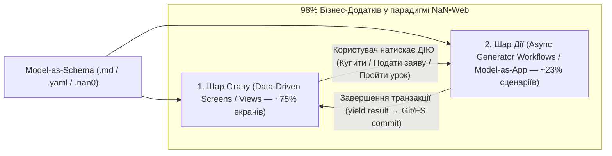

# 🏛️ Архітектурний Синтез та Дорожня Карта Стабілізації `nan0web` (OLMUI & Model-as-App)

> **Джерело первинного аудиту:** Зовнішня оцінка Cursor ([`docs/ARCHITECTURE_ASSESSMENT.md`](/Users/i/src/nan.web/docs/ARCHITECTURE_ASSESSMENT.md))  
> **Вердикт Архітектора та Ради Мудреців (04.11.2026):** Перехід від «нескінченного рефакторингу ядра» до двошарової моделі **Data-Driven Views + Async Generator Workflows**, що покриває **98% бізнес-додатків** при мінімальних витратах на інфраструктуру (Git + Markdown/YAML/nan0 + Vector RAG).

---

## 1. Як покрити 98% бізнес-додатків без пастки «лінійного генератора»

Головне зауваження в [`ARCHITECTURE_ASSESSMENT.md`](/Users/i/src/nan.web/docs/ARCHITECTURE_ASSESSMENT.md) полягало в тому, що сам по собі асинхронний генератор (`Model-as-App`) має оцінку **8/10 для лінійних покрокових сценаріїв**, але **4/10 для дашбордів, каталогів та вільного перегляду станів**.

### Математичне та інженерне рішення (Формула 98%):
Будь-який бізнес-додаток (банк, правовий маркетплейс, освітня платформа, CRM, медіа-портал) складається рівно з двох ортогональних вимірів:

| Вимір додатку | Що це таке в бізнесі | Який механізм `nan0web` відповідає | Чому це дає 98% покриття |
| :--- | :--- | :--- | :--- |
| **1. Data-Driven Screens (Статика та Стан — ~75%)** | Дашборди, статті `IPNews`, сторінки курсу, таблиці рахунків `IndustrialBank`, профілі, каталоги юристів `Oleinik Law` | **`Model-as-Schema` + `db.fetch()` + Декларативні шаблони (`_.md`, `_.yaml`, `_.nan0`)** | Не потребує генератора! Екран миттєво рендериться зі схеми та файлової/Git БД, підтримує reload, deep-links, SEO (SSG) та історію браузера. |
| **2. Interactive Workflows (Процеси та Транзакції — ~23%)** | Онбординг, грошовий переказ, генерація правової заяви на 11 інстанцій, щоденна практика в `sun.app`, оплата 1 BTC | **Асинхронний генератор `Model-as-App` (`yield ask / show / progress / result`) + Чекпойнти** | Перевикористовує порядок діалогу та валідацію одночасно у **Web, CLI, Telegram/Signal боті та AI-чаті** без дублювання бізнес-логіки! |
| **3. Non-Standard Realtime (Ігри, 3D/Video редактори — ~2%)** | Шутери, складні графічні полотна (Figma/Blender) | Спеціалізовані Canvas/WebGL двигуни | Свідомо виносяться за межі OLMUI. |

---

## 2. Таблиця Трансформації Недоліків з `ARCHITECTURE_ASSESSMENT.md` у План Дій

| № | Проблема, виявлена в аудиті Cursor | Корінь проблеми | Архітектурне рішення (З мінімальним входом і максимальним виходом) | Статус / Пріоритет |
| :-: | :--- | :--- | :--- | :---: |
| **1** | **Кілька несумісних реалізацій `runner/hook` у репозиторії** | Еволюційний пошук під час розробки різних пакетів | **Feature Freeze ядра:** Залишити рівно **1 канонічний `GeneratorRunner`** у `@nan0web/ui` та єдиний версіонований контракт інтентів (`ask`, `show`, `progress`, `result`). Усі застарілі раннери видалити. | 🔴 **P0 (Критично)** |
| **2** | **Втрата стану генератора при Reload сторінки (неможливість серіалізації continuation)** | Стан зберігався лише в локальному стеку виклику JS-генератора | **Event-Sourcing / Replay Checkpoints:** Оскільки генератор детермінований, зберігати масив відповідей користувача (`answers: [step1, step2]`) у `localStorage` або `.nan0` сесії. При перезавантаженні сторінки раннер за $1\text{ мс}$ програє масив `answers` до поточного `yield`! | 🟠 **P1 (Високий)** |
| **3** | **Витік UI-термінів у домен (`render('Table')` у `HabitStatusApp.js`)** | Змішування семантики даних і способу відображення | Замінити `render('Table')` на семантичну видачу даних із `Model-as-Schema` (наприклад, колекція об'єктів зі схемою полів). Чи це таблиця, чи картки, чи CLI-список — вирішує виключно адаптер платформи. | 🟡 **P2 (Середній)** |
| **4** | **Web відправляє на сервер цілий документ стану без серверної ре-валідації та CAS** | Демо-режим для single-user прототипу | **Command Execution на сервері:** Клієнт відправляє лише вхідні відповіді (інтент-команду), а той самий `Model-as-App` генератор виконується на сервері в headless-режимі, перевіряє бізнес-правила і робить атомарний запис (Git-коміт або версіонований файл). | 🟠 **P1 (Для Банку)** |

---

## 3. Заміна Важкого Стеку (PostgreSQL/Next.js) на Git + Markdown + Vector RAG

Для запуску курсу **«Суперінтелект.Активація»**, **«Книги свого Буття» (`sun.app`)** та управління проєктами скасовується потреба у дорогій БД PostgreSQL та складних серверах (які в старому `PLATFORM_SPEC.md` оцінювалися у \$30k–\$50k і 3 місяці розробки):

1. **Приватні Git-репозиторії як Суверенна База Даних:**
   - Кожен учасник курсу або проєкт отримує структуроване дерево папок із файлами `**/_.{md|nan0|yaml|json}`.
   - Кожна пройдена практика з 6 серій курсу зберігається як чистий `.md` файл (Глава «Книги Буття»), підписаний ключем учасника.
   - Історія змін, бекапи, версіонування та аудит забезпечуються самим протоколом **Git** (та **IPFS** для фінальної фіксації) за **\$0**.
2. **Векторна База Даних (RAG) лише як Шар Індексації та Пошуку:**
   - Складні обчислення виносяться виключно в шар індексації вже існуючих Markdown/код-проектів (`@nan0web/ai` + локальні ембедінги + `hnswlib` / векторний індекс).
   - Джерелом істини (Source of Truth) завжди залишається людиночитаний **Markdown-файл**, який одночасно ідеально розуміють і Людина, і ШІ-агент.
