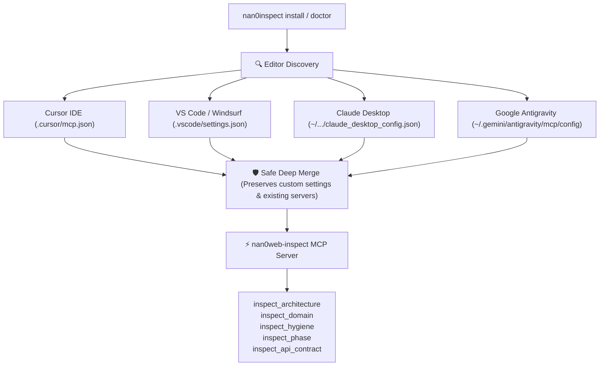

# 🔌 Галерея Можливостей: Cross-Editor Zero-Hallucination Installer & MCP Bridge (v3.10.0)

> **Пакет:** `@nan0web/inspect`  
> **Версія:** `v3.10.0`  
> **Призначення:** Детермінований автоматичний інсталятор та діагност MCP-сервера інспекції для сучасних AI-редакторів (Google Antigravity, Cursor IDE, VS Code, Windsurf, Claude Desktop) із гарантією збереження існуючих конфігурацій (Deep Merge).

---

## 🧭 Чому це важливо (Safe Zero-Hallucination Integration)



---

## 🎮 Доступні CLI команди та приклади

### 1. Автоматична детекція та інсталяція MCP сервера
```bash
nan0inspect install
```
**Вивід у терміналі (OLMUI Table):**
```text
┌───────────────────┬───────────────┬──────────────────────────────────────────┐
│ Editor            │ Status        │ Config Path                              │
├───────────────────┼───────────────┼──────────────────────────────────────────┤
│ Google Antigravity│ ✅ Configured │ ~/.gemini/antigravity/mcp/config         │
│ Cursor IDE        │ ✅ Configured │ /workspace/.cursor/mcp.json              │
│ VS Code / Windsurf│ ⚪ Not Detected│ /workspace/.vscode/settings.json         │
│ Claude Desktop    │ ⚪ Not Detected│ ~/Library/Application Support/Claude/... │
└───────────────────┴───────────────┴──────────────────────────────────────────┘
[success] Installation complete: 2 environment(s) updated.
```

---

### 2. Діагностика середовища та перевірка здоров'я інтеграції
```bash
nan0inspect doctor
```
**Результат:**
```text
┌───────────────────┬──────────┬────────────────┬──────────────────────────────┐
│ Editor            │ Detected │ MCP Configured │ Config Path                  │
├───────────────────┼──────────┼────────────────┼──────────────────────────────┤
│ Google Antigravity│ Yes      │ ✅ Active      │ ~/.gemini/.../config         │
│ Cursor IDE        │ Yes      │ ✅ Active      │ /workspace/.cursor/mcp.json  │
│ VS Code / Windsurf│ No       │ ❌ Inactive    │ /workspace/.vscode/...       │
│ Claude Desktop    │ No       │ ❌ Inactive    │ ~/Library/...                │
└───────────────────┴──────────┴────────────────┴──────────────────────────────┘
[success] ✅ Green Ready: inspect MCP server is configured and ready for agents.
```

---

### 3. Виклик нового інструменту `inspect_api_contract` через MCP
Інструмент дозволяє AI-агенту миттєво зняти сигнатури класу без тіл функцій:
```json
{
  "name": "inspect_api_contract",
  "arguments": {
    "path": "packages/inspect/types/domain/ast/FastApiDiscovery.d.ts",
    "level": "methods"
  }
}
```
**Відповідь MCP:**
```yaml
FastApiDiscovery:
  description: FastApiDiscovery — High-speed AST extraction of class declarations, fields, and method contracts.
  methods:
    extractFromSource(...): Extracts API contract from TypeScript/JavaScript source string.
    extractFromFile(...): Reads file via injected DB and extracts API contract.
    toNanoYaml(...): Formats extracted contract into concise Nano/YAML outline.
```
