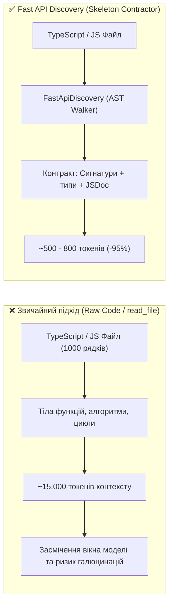

# ⚡ Галерея Можливостей: Fast API Discovery & Skeleton AST Contractor (v3.9.0)

> **Пакет:** `@nan0web/inspect`  
> **Версія:** `v3.9.0`  
> **Призначення:** Миттєва екстракція синтаксичних AST-контрактів коду, сигнатур та описів без тіл функцій для економії **90–95% токенів контексту** та чистого огляду API.

---

## 🧭 Чому це важливо (Проблема vs Рішення)



---

## 🎮 Галерея можливостей та живі приклади команд

Ви можете скопіювати та виконати будь-яку з наведених команд у терміналі проєкту:

### 1. Супер-короткий огляд методів з дескрипшнами (Компактний Nano)
```bash
nan0inspect api packages/inspect/types/domain/ast/FastApiDiscovery.d.ts --level methods
```
**Результат:**
```yaml
FastApiDiscovery:
  description: FastApiDiscovery — High-speed AST extraction of class declarations, fields, and method contracts.
  methods:
    extractFromSource(...): Extracts API contract from TypeScript/JavaScript source string.
    extractFromFile(...): Reads file via injected DB and extracts API contract.
    toNanoYaml(...): Formats extracted contract into concise Nano/YAML outline.
```

---

### 2. Детальний словник Варіанту В (`--style full`) з параметрами та типами повернення
```bash
nan0inspect api packages/inspect/types/domain/ast/FastApiDiscovery.d.ts --level methods --style full
```
**Результат:**
```yaml
FastApiDiscovery:
  description: FastApiDiscovery — High-speed AST extraction of class declarations, fields, and method contracts.
  methods:
    extractFromSource(...):
      description: Extracts API contract from TypeScript/JavaScript source string.
      params:
        - "source: string"
        - "options?: { ... }"
      result: "{ exports: Record<string, ClassContract>; deps?: string[]; }"
    extractFromFile(...):
      description: Reads file via injected DB and extracts API contract.
      params:
        - "filePath: string"
        - "options?: any"
      result: "Promise<{ exports: Record<string, ClassContract>; deps?: string[]; }>"
```

---

### 3. Зчитування JavaScript схеми (`Model-as-Schema` з об'єктів конфігурації `help`)
```bash
nan0inspect api packages/inspect/src/domain/AuditorModel.js --only static
```
**Результат:**
```yaml
AuditorModel:
  description: AuditorModel — Base model for all architecture auditors.
  fields:
    static alias: ""
    static dir: Target directory to audit
    static help: Show help
    static fix: Automatically apply fixes where possible
    static platform: Language platform (js, python)
    static timeout: Execution timeout in seconds
```

---

### 4. Каталог аудиторів у вигляді повноцінної OLMUI Таблиці
```bash
nan0inspect list
```
**Результат:**
```text
📋 Registered Architecture Auditors
Alias        Auditor                   Description                                                                                              
audit        ArchitectureAuditor       Full Inspector Pipeline — analyzes package architecture for compliance.                                  
snapshots    SnapshotAuditor           Validates UI snapshots against hallucinations and localization leaks.                                    
theming      OlmuiThemingAuditor       Checks UI styles for hardcoded values (colors, measurements, layouts) and enforces theme variable usage. 
phase        PhaseAuditor              PhaseAuditor                                                                                             
hygiene      HygieneAuditor            HygieneAuditor                                                                                           
exports      ExportAuditor             ExportAuditor                                                                                            
domain       DomainAuditor             DomainAuditor                                                                                            
verification VerificationAuditor       VerificationAuditor                                                                                      
circular     CircularDependencyAuditor Detects circular dependency chains in the source code.                                                   
workflows    BuildWorkflowsApp         Compiles YAML FrontMatter workflows and anchors into lightweight JSON manifests.                         
list         ListAuditorsApp           Catalog of registered auditors, aliases, and architectural responsibilities.                             
api          FastApiApp                Extracts minimalist API outline and method/field contracts without bodies.                               
```

---

## 🧪 Підтвердження Якості (Verification Evidence)

Усі критерії надійності доведені автоматизованими тестами та аудиторами монорепозиторію:

| Контрольна перевірка | Результат | Що перевірено |
| :--- | :---: | :--- |
| **Релізний контракт `task.spec.js`** | `PASS` (6/6) | Парсинг d.ts/js, фільтри `--level`, `--only`, `--include-deps`, NaN0 серіалізація, CLI |
| **Unit-тести пакета (`pnpm run test`)** | `PASS` (90/90) | Усі інспектори, AST, конфігурації та модулі |
| **Регресійні тести (`test:release`)** | `PASS` (37/37) | Релізи v1.0, v3.2, v3.6, v3.7, v3.8 |
| **Документаційні тести (`test:docs`)** | `PASS` (7/7) | `src/docs/README.md.js` |
| **TypeScript типізація (`tsc`)** | `PASS` | Згенеровано `.d.ts` у `types/domain/ast/` та `types/domain/app/` |
| **Стиль та форматування (`prettier`)** | `PASS` | Всі файли відповідають конвенції стилю монорепозиторію |
| **Гігієна експортів та мертвого коду (`knip`)** | `PASS` | Нуль невикористаних залежностей або забутих експортів |

---

## 📦 Точки доступу (Exports & Integration)

1. **CLI підкоманди:**
   - `nan0inspect api <file>`
   - `nan0inspect outline <file>`
2. **Програмний інтерфейс (ESM):**
   ```javascript
   import { FastApiDiscovery } from '@nan0web/inspect'

   const discovery = new FastApiDiscovery()
   const contract = discovery.extractFromSource(sourceCode, {
     level: 'methods',
     only: 'async'
   })
   const nanoString = discovery.stringify(contract, { style: 'short' })
   ```
3. **Прямий сабпатч імпорт:**
   ```javascript
   import { FastApiDiscovery } from '@nan0web/inspect/domain/ast/FastApiDiscovery'
   ```
