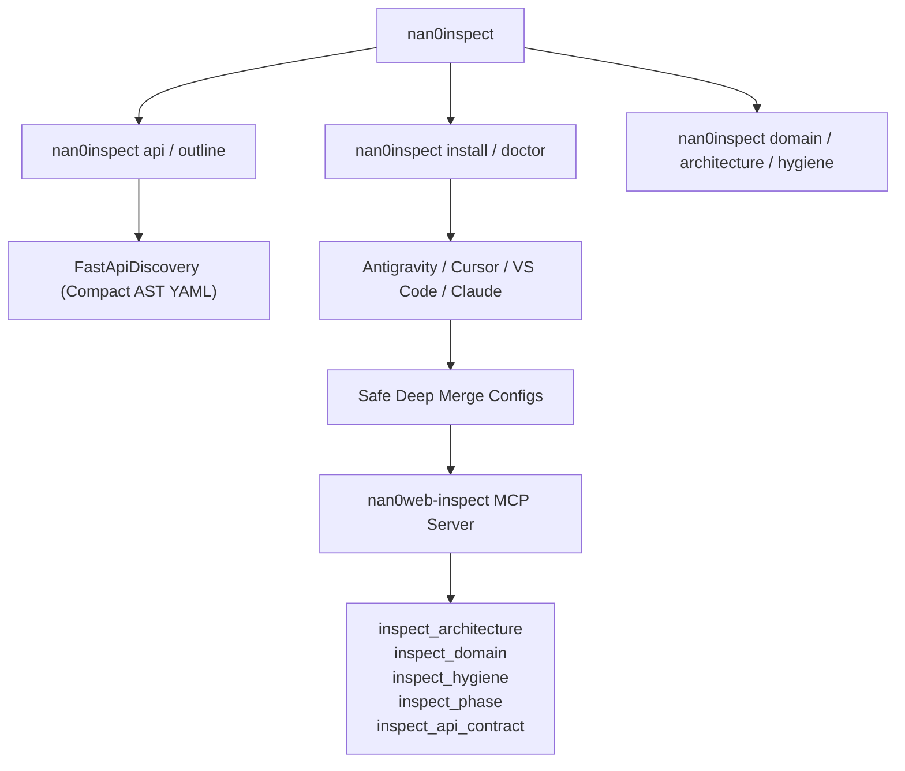

# 🔌 Галерея Можливостей: Fast API Discovery, Editor Installer & MCP Bridge (v3.9.0)

> **Пакет:** `@nan0web/inspect`  
> **Версія:** `v3.9.0`  
> **Призначення:** Комплексний набір інструментів інспекції: надшвидка екстракція AST-контрактів без коду (`api`/`outline`), автоматичне підключення до AI-редакторів (Google Antigravity, Cursor, VS Code, Claude Desktop) через MCP, та нульовий технічний борг доменної моделі.

---

## 🧭 Архітектура можливостей



---

## 🎮 Доступні CLI команди та приклади

### 1. Екстракція контракту API (економія до 90% токенів)
```bash
nan0inspect api packages/inspect/types/domain/ast/FastApiDiscovery.d.ts --level methods
```
**Результат (Nano/YAML outline):**
```yaml
FastApiDiscovery:
  description: FastApiDiscovery — High-speed AST extraction of class declarations, fields, and method contracts.
  methods:
    extractFromSource(...): Extracts API contract from TypeScript/JavaScript source string.
    extractFromFile(...): Reads file via injected DB and extracts API contract.
    toContractObject(...): Formats extracted contract into structured dictionary for NaN0 serialization.
    stringify(...): Formats extracted contract into concise Nano string via NaN0.stringify.
    toNanoYaml(...): Backward compatibility helper for toNanoYaml.
```

---

### 2. Автоматична детекція та інсталяція MCP сервера
```bash
nan0inspect install
```
**Вивід у терміналі (OLMUI Table):**
```text
┌───────────────────┬───────────────┬──────────────────────────────────────────┐
│ Editor            │ Status        │ Config Path                              │
├───────────────────┼───────────────┼──────────────────────────────────────────┤
│ Google Antigravity│ ✅ Configured │ ~/.gemini/antigravity/mcp/config         │
│ Cursor IDE        │ ✅ Configured │ /workspace/.cursor/mcp.json              │
│ VS Code / Windsurf│ ⚪ Not Detected│ /workspace/.vscode/settings.json         │
│ Claude Desktop    │ ⚪ Not Detected│ ~/Library/Application Support/Claude/... │
└───────────────────┴───────────────┴──────────────────────────────────────────┘
[success] Installation complete: 2 environment(s) updated.
```

---

### 3. Діагностика середовища (Doctor Check)
```bash
nan0inspect doctor
```
Перевіряє доступність файлів конфігурації та виконує smoke-тест MCP-сервера.
